# PdaNet Windows (Portable)

PdaNet Windows lets your Windows PC use your Android phone's internet connection. It is a single portable program, so there is nothing to install and you do not need administrator rights to run it.

This is an independent project inspired by PdaNet. It is not made by, or connected to, the makers of PdaNet. Please use it only with your own phone and follow the rules of your mobile plan.

## What it can do

- Share your phone's internet with your PC through a USB cable
- Also work with your phone's WiFi hotspot
- Send your PC's traffic through whatever connection your phone is using, including a VPN that is running on the phone
- Help stop your mobile carrier from noticing that you are sharing (this is often called tethering)
- Guide you with a step by step screen that checks your phone is ready before you connect
- Show live speed, data used, signal strength, and a plain language activity log on a modern dark screen
- Show which apps use the internet, the websites each app visits and the data each app uses, live
- Block an app or a website to save phone data, with no admin
- Make your PC read as another city, time zone and region, with no admin

## What it looks like

Pick how to connect, follow the short checklist so your phone is ready, then press the button

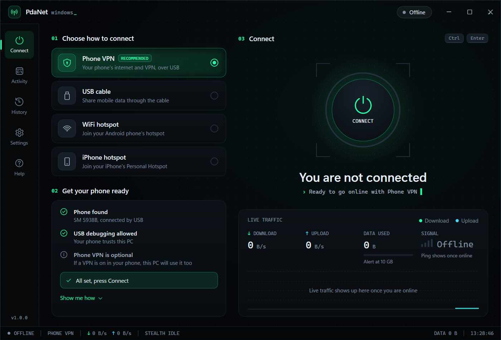

<table>
  <tr>
    <td width="50%" valign="top">
      <b>You are online</b><br>
      Live download, upload, data used, signal and ping
      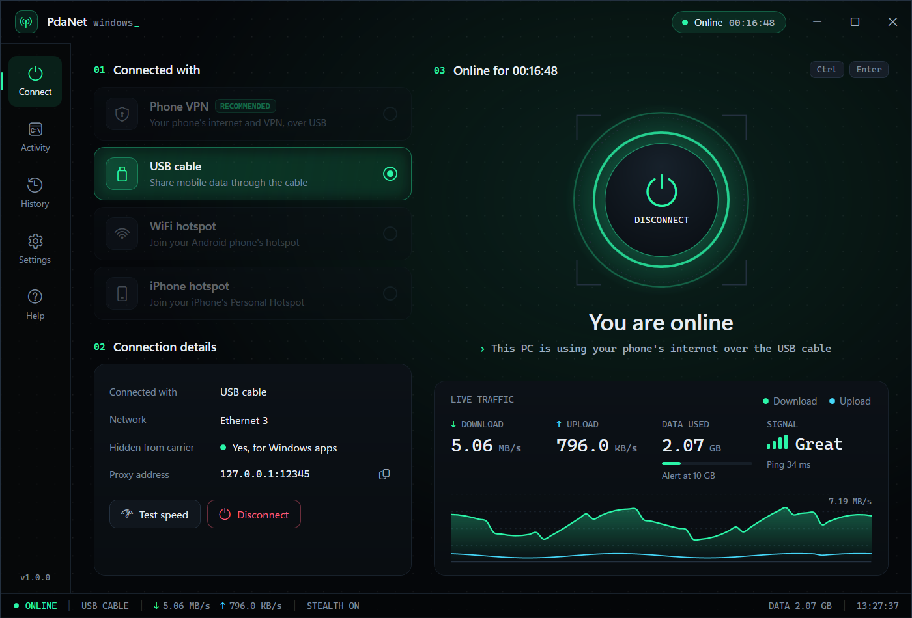
    </td>
    <td width="50%" valign="top">
      <b>It walks you through it</b><br>
      Clear progress, one step at a time
      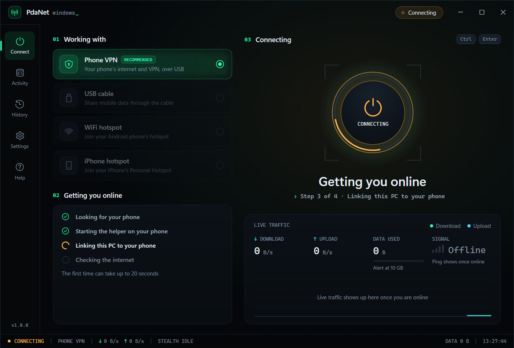
    </td>
  </tr>
  <tr>
    <td width="50%" valign="top">
      <b>Help when something is off</b><br>
      It says what to do in plain words
      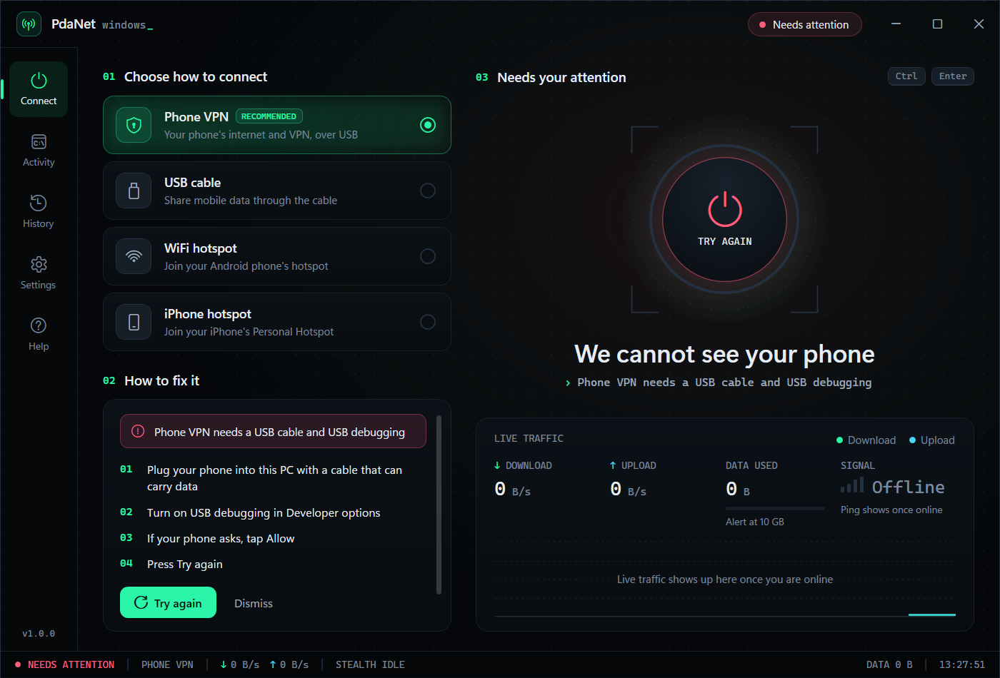
    </td>
    <td width="50%" valign="top">
      <b>Settings you understand</b><br>
      Every option has a plain explanation, hover the info dot to read it
      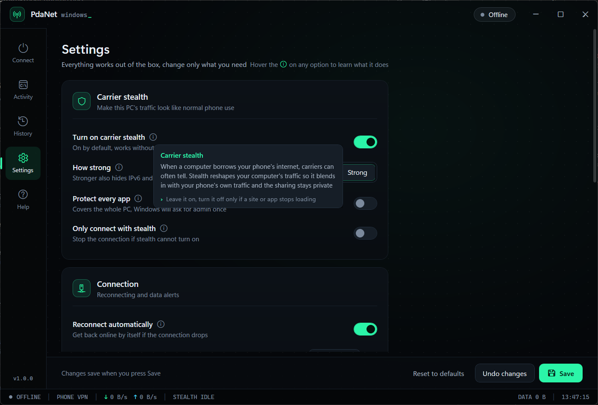
    </td>
  </tr>
  <tr>
    <td width="50%" valign="top">
      <b>Answers built in</b><br>
      Plain help for the common questions
      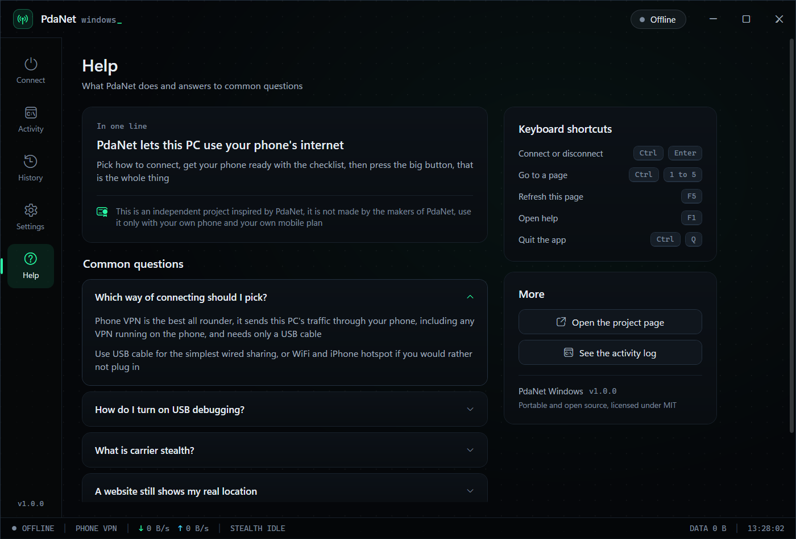
    </td>
    <td width="50%" valign="top">
      <b>A full activity log</b><br>
      For when you want the detail
      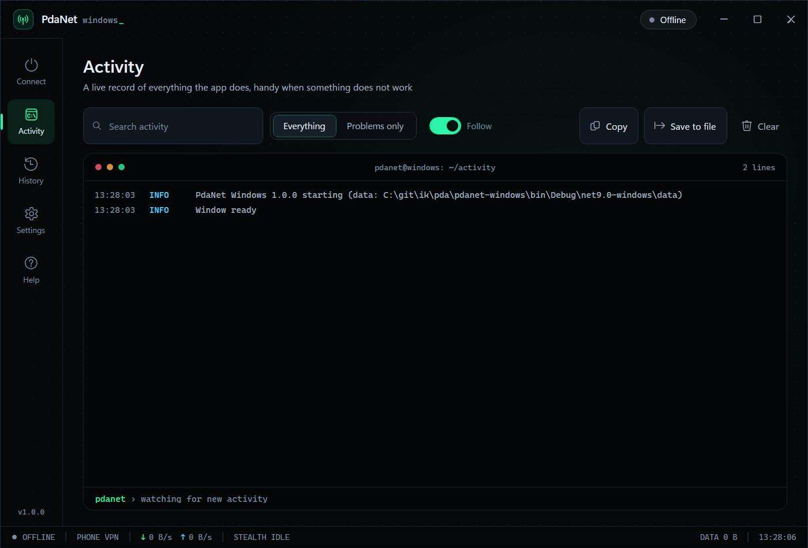
    </td>
  </tr>
  <tr>
    <td width="50%" valign="top">
      <b>See every app online</b><br>
      The websites and the data of each app, live
      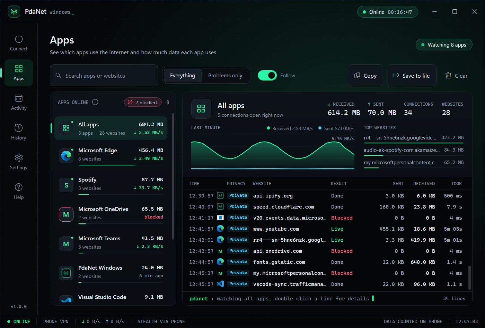
    </td>
    <td width="50%" valign="top">
      <b>Details of every line</b><br>
      Double click a line to see the details
      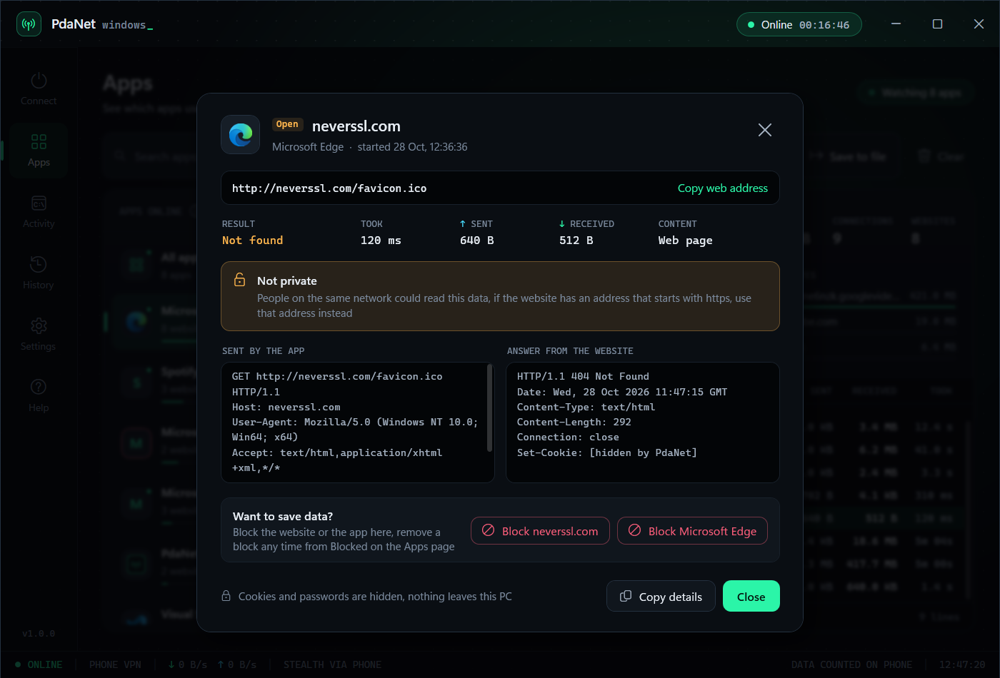
    </td>
  </tr>
  <tr>
    <td width="50%" valign="top">
      <b>Block an app or a website</b><br>
      Right click a line, no admin needed
      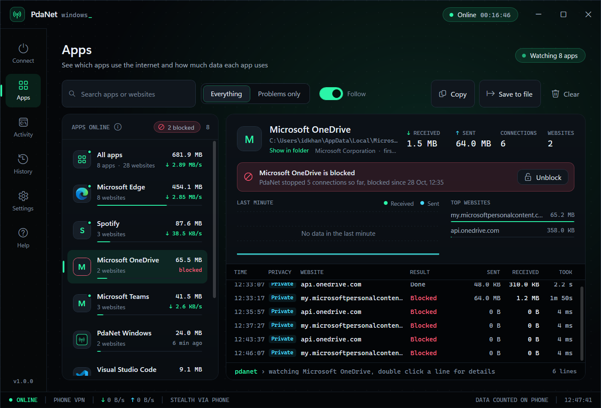
    </td>
    <td width="50%" valign="top">
      <b>All your blocks</b><br>
      See and remove blocks in one place
      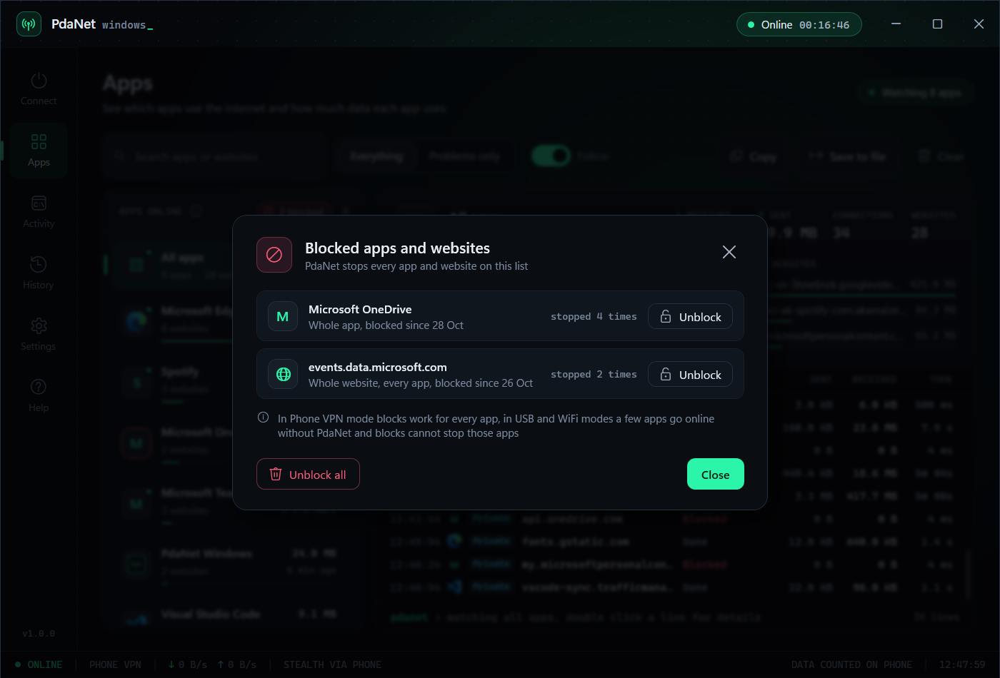
    </td>
  </tr>
</table>

## What you need

- A Windows 10 or Windows 11 PC, 64 bit
- An Android phone
- A USB cable
- USB debugging turned on in the phone's Developer options (only for the phone VPN mode)

## Getting the app

Download `PdaNetPortable.exe` from the Releases page of this project. Save it anywhere you like, such as your Desktop or a USB stick, and double click to open it. There is no setup step.

## How to use it

Pick how to connect in step 1, follow the short checklist in step 2 so your phone is ready, then press the large round button in step 3. Press it again to disconnect, which returns your PC's network settings to normal.

<details>
<summary><h3>Phone VPN mode (recommended)</h3></summary>

Use this when you want your PC to go online through the same connection, and the same VPN, that your phone is using. You do not need to switch anything on in the phone's USB menu.

1. On the phone, turn on Developer options and USB debugging
2. Connect the phone to the PC with a USB cable
3. On the phone, tap Allow when it asks whether to trust this computer
4. In the app, choose Phone VPN and press the connect button
5. Open a browser and visit a site that shows your location

If the phone is connected to a VPN, your PC will now appear to be in the same country as that VPN.

</details>

<details>
<summary><h3>USB mode</h3></summary>

Use this to share the phone's internet over the cable.

1. On the phone, turn on USB tethering, found under Settings, then Mobile Hotspot and Tethering
2. In the app, choose USB cable and press the connect button

</details>

<details>
<summary><h3>WiFi mode</h3></summary>

Use this to share the phone's hotspot.

1. On the phone, turn on the WiFi hotspot
2. In the app, choose WiFi hotspot, pick your hotspot or type its name and password, and press the connect button

</details>

<details>
<summary><h2>Hiding tethering from your carrier</h2></summary>

Some mobile plans try to detect when you share your phone's internet with another device. The app can make your PC's traffic look more like normal phone traffic, which helps avoid this. It runs on its own and does not need administrator rights.

This cannot be guaranteed on every network. The strongest option is the phone VPN mode above, because a VPN hides the traffic by encrypting it.

</details>

<details>
<summary><h2>Pretend you are elsewhere</h2></summary>

The app can set your PC's time zone, and optionally its country and date and number formats, to match another city. It needs no admin, and it is undone the moment you turn it off. Open it from the globe button on the home screen, or from Settings.

This changes what Windows and your apps read, such as the clock and the calendar. For what websites and online services see, which comes from your internet address, use Phone VPN mode with a VPN running on the phone. Together your PC reads as that place both on the desktop and online.

- Pick a city, or search for one
- Watch a live clock for that city next to your real time
- Turn it on, or have it turn on by itself each time you connect
- Turn it off to put your real time zone and region straight back

</details>

<details>
<summary><h2>See which apps use the internet</h2></summary>

The Apps page shows every app on your PC that uses the internet through PdaNet, live. Pick an app to see the websites the app visits, the data the app sends and receives, a chart of the last minute and one line for every connection. Double click a line to see the details.

- Websites with an address that starts with https stay private. PdaNet sees the website name, the time and the amount of data, never the content
- For websites with an address that starts with http, PdaNet shows what the app sent and the answer, with passwords hidden
- Search for an app or a website, show only problems, copy lines or save lines as a file for Excel
- Nothing is saved or sent anywhere unless you save a file yourself

App watch works in every mode. In Phone VPN mode PdaNet adds a small step in front of the phone link, so PdaNet can tell the apps apart. To turn app watch off, open Settings, then Apps. A few apps go online without PdaNet, and those apps do not show up.

<details>
<summary><h3>Block apps and websites</h3></summary>

Right click a line on the Apps page to block the app or the website, for one app or for every app. The details of a line have the same buttons. Blocks need no admin rights and start right away, open connections close at once. Blocked tries show up as red lines. Blocks stay on every time you connect. To see or remove blocks, open Blocked on the Apps page, or Settings.

- In Phone VPN mode blocks work for every app
- In USB and WiFi modes most apps go online through PdaNet, but a few apps, such as Windows Update, go online without PdaNet, and blocks cannot stop those apps without admin rights

</details>

</details>

<details>
<summary><h2>Settings</h2></summary>

Open Settings from the main screen to change things such as

- Whether hiding (stealth) is on
- How many times to retry when the connection drops
- How much data to use before you see a warning
- Whether the Apps page shows the apps that use the internet
- Which port the app uses on your PC
- A path to your own copy of adb, if you prefer that

</details>

<details>
<summary><h2>If something does not work</h2></summary>

- Phone not found in VPN mode, check that USB debugging is on and that you tapped Allow on the phone
- USB mode says there is no connection, turn on USB tethering on the phone and keep mobile data on
- The browser still shows your real location, some company or school PCs force their own network proxy that overrides the app, in that case open the connection details on the Connect page, copy the proxy address, and set it in your browser
- Nothing seems to happen when you connect, open the Activity page in the app to see which step failed

</details>

<details>
<summary><h2>Privacy</h2></summary>

The app keeps its settings in a folder named data next to the program. WiFi passwords are stored in encrypted form using Windows. The app itself does not send your information anywhere. The Apps page keeps the list only while PdaNet runs, unless you save the list to a file.

</details>

<details>
<summary><h2>For developers</h2></summary>

The app is built with .NET 9 and WPF for Windows. The released program is a single self contained file, so it carries its own copy of .NET, a small Android helper, and Google's adb tool. That is why it needs no installer and no admin rights.

Build it:

```
cd pdanet-windows
dotnet publish -c Release
```

The finished program appears at `pdanet-windows/dist/PdaNetPortable.exe`.

The Android helper is a small Java HTTP proxy in `agent/ProxyMain.java`. A prebuilt copy is already included in the app, so you only need to rebuild it if you change that file. The rebuild uses the Eclipse Java compiler and Google's d8 tool and needs no Android SDK. See `agent/build.bat` for the two tools to download and the steps.

Three built in checks run without opening the window:

```
PdaNetPortable.exe --selftest
PdaNetPortable.exe --selftest-agent
PdaNetPortable.exe --selftest-monitor
```

The last check tests the Apps page and blocks. The check changes no Windows setting and needs no phone.

</details>

<details>
<summary><h2>How it works, in short</h2></summary>

In the phone VPN mode the app runs a tiny helper on the phone through adb and then points Windows at it. Because that helper runs as a normal program on the phone, your PC's traffic follows the phone's connection, including any VPN. In USB and WiFi modes the app routes traffic through the phone and adjusts it so the connection looks like ordinary phone use.

</details>

<details>
<summary><h2>License</h2></summary>

MIT. See the LICENSE file.

</details>

<details>
<summary><h2>Thanks</h2></summary>

Inspired by the pdanet-linux project and by PdaNet. All trademarks belong to their owners.

</details>
